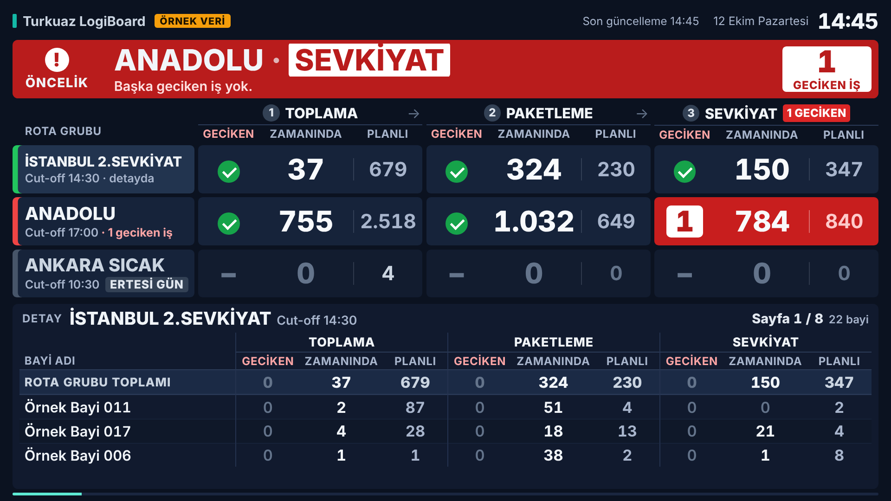

# Turkuaz LogiBoard – Depo İçi Ekran

ERP'den gelen `Turkuaz_Logiboard` verisini depo içi ekranlarda (Omma / Signalive) gösteren tek dosyalık HTML içerik: [`202610121828.html`](202610121828.html).
Dosya adı revizyonun tarih ve saatidir (YYYYAAGGSSDD, Türkiye saati); her revizyonda yeni adla gelir.
Sahadaki personelin 3–10 metreden bakıp **2 saniyede ne yapacağını anlaması** için andon panosu mantığıyla tasarlandı.



## Ekranda ne var?

**Üst bar:** Saat, tarih ve "Son güncelleme" her zaman **Türkiye saatiyle (UTC+3)** gösterilir. Cihazın saat dilimi yanlış ayarlı olsa da ekrandaki saat doğrudur; cihazın saatinin kendisi (NTP) doğru olmalıdır. Saat yaklaşık 10 metreden okunacak büyüklüktedir.

1. **Öncelik bandı (en üstte, her zaman görünür)**
   - Kırmızı **ÖNCELİK**: gecikmesi olan gruplardan **sevk saati en erken olan** *rota grubu · süreç* ve geciken sayısı, örneğin "İSTANBUL 2.SEVKİYAT · [SEVKİYAT] – 4 GECİKEN KALEM". Süreç beyaz etiketle ayrılır; böylece grup adındaki "SEVKİYAT" ile karışmaz. İkinci satırda "Sırada: …" listesi ve toplam geciken kalem sayısı yer alır.
   - Yeşil **GECİKME YOK** / "Tüm kalemler zamanında.": hiçbir yerde geciken kalem yoksa görünür.
   - Sarı **VERİ ESKİ**: veri `staleMinutes` dakikadan eskiyse ya da bağlantı koptuysa bandın sol kutusu sarıya döner ve alt satırda "Veri güncel değil — gösterilen durum değişmiş olabilir." yazar.
2. **Andon panosu**
   - Rota grupları **sevk saatine göre** sıralanır (aşağıdaki tablo). Grup adının altında "Sevk 14:30" yazar.
   - **Sevk saati durumu** (Türkiye saatiyle): sevke 60 dakika ya da daha az kaldıysa saat **amber kutuda** görünür. Saat geçtiği hâlde grupta GECİKEN/ZAMANINDA kalem duruyorsa **beyaz kutuda kırmızı "14:30 GEÇTİ"** yazar.
   - **Ertesi günün grupları alttaki gri şeride alınır.** GECİKEN ve ZAMANINDA değeri olmayan, yalnızca PLANLI değeri olan grup ertesi günün işidir. Bugünün grupları varken bu gruplar satır olarak çizilmez; panonun altındaki **ERTESİ GÜN** şeridinde adları ve sevk saatleriyle listelenir. Böylece bugünün satırları büyük kalır. Cuma günü önce Cumartesi grupları, diğer günler önce hafta içi grupları gelir. Bugün hiç iş yoksa ertesi günün grupları satır olarak gösterilir.
   - Her grup için süreçler TOPLAMA → PAKETLEME → SEVKİYAT sırasıyla, GECİKEN / ZAMANINDA / PLANLI değerleriyle gösterilir; değerler ortalıdır.
   - Geciken kalemi olan kutu **kırmızı** yanar ve beyaz kutu içinde geciken sayısını gösterir. Bugünün gruplarında geciken yoksa yeşil onay işareti görünür. Grup adının altında "Geciken yok" yazmaz.
   - **0** değerleri sönük ve küçük yazılır; dolu sayılar öne çıkar.
   - Süreç başlıklarında o süreçteki toplam geciken sayısı rozet olarak görünür, örneğin "5 GECİKEN".
3. **Detay tablosu**
   - Yalnızca bugünün grupları detayda gösterilir; sıra panoyla aynıdır (sevk saati). Başlıkta "Sevk Saati 14:30" yazar. Ertesi günün gruplarının detayı gösterilmez.
   - En üstte, her sayfada **ROTA GRUBU TOPLAMI** satırı durur. Bu satır grubun ERP toplamlarını gösterir; panodaki rakamlarla aynıdır.
   - Altında **bayi kırılımı** yer alır. Yalnızca GECİKEN ya da ZAMANINDA değeri olan bayiler listelenir. Yalnızca PLANLI değeri olan bayiler ertesi günün işidir ve gösterilmez; sayfa bilgisinde "bugün işi olmayan N bayi gizli" yazar.
   - **Geciken bayiler en üstte**, kırmızı zemin üzerinde gösterilir. Bayinin hangi süreçte geciktiği koyu kırmızıyla işaretlenir.
   - Sayfalar `pageSeconds` aralıkla döner. Panoda detayı gösterilen grubun satırında "· detayda" yazar.
   - Panonun altına 4 detay satırından azı sığıyorsa pano ve detay sırayla tam ekran gösterilir (yatay 1080p ekranda genellikle böyledir). Pano sırası geldiğinde az satır varsa rakamlar ekranı dolduracak kadar büyür. Öncelik bandı her zaman görünür kalır.
4. **Hareket (az ve anlamlı)**
   - Bir güncellemede bir kutunun GECİKEN sayısı artarsa o kutunun çerçevesi **3 kez parlar** ve durur. Pano o sırada ekranda değilse parlama pano görününce oynar. İlk açılışta ve değerlerin çoğu birden değiştiğinde parlama olmaz.
   - Öncelik kutusu açılıştan ya da gecikme arttıktan sonra **15 dakika** yavaşça yanıp söner, sonra sabit kırmızı kalır.
   - İlerleme çubuğu sayfanın ne zaman değişeceğini gösterir.
   - Ekran yanığına karşı sayfa 15 dakikada bir 1–2 piksel kayar; gözle fark edilmez.
   - Yanıp sönen rakam, kayan yazı ya da sayarak artan sayı yoktur.

Ekran 1080p, 4K, ultra geniş ve dikey ekranlarda ölçeklenir. Sayılar asla kesilmez; sığmazsa yazı küçülür.

Alan eşleşmesi: `…Past` → **GECİKEN**, `…Today` → **ZAMANINDA**, `…Planned` → **PLANLI**. Başlıkları değiştirmek için dosyadaki `PERIODS` listesini düzenleyin.

### Sevk saatleri (`CONFIG.shipTimes`)

| Rota grubu | Sevk saati |
|---|---|
| ANKARA SICAK | 10:30 |
| ADAPAZARI SICAK | 11:00 |
| İSTANBUL 1.SEVKİYAT | 11:30 |
| BURSA SICAK | 12:00 |
| İSTANBUL 2.SEVKİYAT | 14:30 |
| ANADOLU | 17:00 |
| CUMARTESİ İSTANBUL (Cumartesi) | 12:30 |
| CUMARTESİ ANADOLU (Cumartesi) | 13:30 |

- **Eşleşme kuralı:** Ad, büyük/küçük harf ve noktalama farkı gözetmeden eşleşir; örneğin "İstanbul 1. Sevkiyat" = "İSTANBUL 1.SEVKİYAT". Birebir eşleşme yoksa, listedeki adın tüm kelimeleri grup adında geçiyorsa eşleşir; örneğin "CUMARTESİ ANADOLU SEVKİYAT" → 13:30.
- **Listede olmayan grup** saatsiz gösterilir ve kendi bloğunun sonuna gider.
- **Farklı yazımlar:** Bir girdiye `aliases: ['...']` eklenebilir.
- **Yeni grup:** Listeye bir satır eklenir, örneğin `{ name: 'İZMİR SICAK', time: '13:00' }`. Cumartesi grupları için `sat: true` eklenir.

## Omma'ya kurulum

1. Omma'da Logiboard için ayrı bir **içerik (content)** oluşturun ve **Code Editor**'e HTML dosyasının tamamını yapıştırın. Dosya kendi içinde tamdır; dışarıdan font, kütüphane ya da görsel yüklemez.
2. Bu içeriğe **Turkuaz_Logiboard (#3887)** veri kaynağını bağlayın. Başka bir projenin içeriğine ya da sahnesine koymayın: sayfa yalnızca içinde çalıştığı içeriğe bağlı veri kaynaklarını görebilir.
3. İçeriği kaydedin, **Test → Update Test** ile kontrol edin ve ekranlara yayınlayın.

Playlist'teki "HTML ekle" widget'ını ya da Web sitesi/URL öğesini kullanmayın. Omma'nın `window.omma` yardımcısı yalnızca Code Editor içeriğinde garanti edilir.

Sayfa Omma'nın [content helper](https://github.com/signalive/content-api-docs/blob/master/content-helper.md) API'sini kullanır: `omma.setVersion('v1')`, `omma.ready()` ve `omma.datasource`. Veri güncellendiğinde (`ds.on('update')`) ekran sayfa yenilenmeden güncellenir ve gösterdiği grup ile sayfada kalır.

**Güvenlik:**
- Sayfa Omma yardımcısını bulamazsa **örnek veri göstermez**. 15 saniye bekler, ardından ekrana açıklayıcı bir mesaj yazar ve aramaya devam eder. Sahada hiçbir koşulda uydurma rakam görünmez.
- Veri kaynağı görünmezse ekranda cihazın gördüğü veri kaynakları (ad, numara, ilk alanlar) listelenir ve sayfa 10 saniyede bir yeniden dener.

### Veri kaynağı ve ERP bağlantısı

- Ekran veriyi yalnızca Omma'nın veri kaynağından okur. ERP'nin veriyi Omma'ya nasıl ilettiği (veri kaynağının "force" adresi ve token'ı, ya da Omma'nın periyodik çektiği bir adres veya betik) ekranı etkilemez.
- **Token'ı ve force adresini bu HTML'e yazmayın.** HTML her ekrana dağıtılır; içindeki bilgi her cihazda okunabilir. Token yalnızca ERP tarafındaki entegrasyonda dursun.

## Beklenen veri yapısı

Veri doğrudan dizi olarak ya da `Turkuaz_Logiboard` anahtarı altında gelebilir (JSON metni olarak, sarmalanmış ya da farklı harf düzeniyle gelmesi de sorun değil):

```json
[
  {
    "DispatchRouteGroupTitle": "ANADOLU",
    "TotalPickingPast": 0,  "TotalPickingToday": 1,     "TotalPickingPlanned": 2117,
    "TotalPackingPast": 0,  "TotalPackingToday": 1452,  "TotalPackingPlanned": 891,
    "TotalShippingPast": 1, "TotalShippingToday": 1920, "TotalShippingPlanned": 1235,
    "Details": [
      { "CustomerTitle": "OTOMOL İZMİR",
        "PickingPast": 0, "PickingToday": 0, "PickingPlanned": 4,
        "PackingPast": 0, "PackingToday": 16, "PackingPlanned": 11,
        "ShippingPast": 1, "ShippingToday": 9, "ShippingPlanned": 10 }
    ]
  }
]
```

### `Details` alanları

Detay tablosunun sütunları **veriden otomatik çıkarılır**. ERP'de alan eklenip çıkarılınca kodu değiştirmek gerekmez:

- Metin alanları solda gösterilir (`CustomerTitle` → **BAYİ ADI**).
- `PickingPast`, `PackingToday`, `ShippingPlanned` gibi alanlar (başında `Total` olsun ya da olmasın) **Toplama / Paketleme / Sevkiyat** başlıkları altında gruplanır. Geciken bayileri bulmak, sıralamak ve ertesi günün işini ayırmak için bu alanlar kullanılır.
- Diğer sayısal alanlar en sağda gösterilir.
- Yeni metin alanlarının başlıklarını Türkçeleştirmek için dosyadaki `LABELS` nesnesine alan adı ekleyin, örneğin `OrderNo: 'Sipariş No'`.
- Gösterilmesini istemediğiniz alanları `CONFIG.hiddenDetailColumns` içine yazın, örneğin `['Id']`.

## Ayarlar (`CONFIG`)

| Ayar | Varsayılan | Açıklama |
|---|---|---|
| `title` | `Turkuaz LogiBoard` | Üst başlık |
| `datasourceId` | `3887` | Omma veri kaynağı numarası (force adresindeki `/datasource/3887/`); önce buna bakılır |
| `datasourceName` | `Turkuaz_Logiboard` | Omma veri kaynağı adı (numara bulunamazsa) |
| `rootKey` | `Turkuaz_Logiboard` | Veri nesne içinde geliyorsa listenin anahtarı |
| `groupTitleKey` | `DispatchRouteGroupTitle` | Grup başlığı alanı |
| `detailsKey` | `Details` | Alt detay listesi alanı |
| `shipTimes` | (yukarıdaki tablo) | Rota gruplarının sevk saatleri ve sıralaması (eski ad `cutoffs` da okunur) |
| `shipSoonMinutes` | `60` | Sevke bu kadar dakika ya da daha az kaldıysa saat amber kutuda |
| `nextDayStrip` | `true` | Bugünün grupları varken ertesi günün grupları alttaki şeritte |
| `detailActiveOnly` | `true` | Detayda yalnızca GECİKEN/ZAMANINDA değeri olan bayiler |
| `rowUnit` | `bayi` | Detay satırlarının birimi ("123 bayi") |
| `pageSeconds` | `10` | Detay sayfasının ekranda kalma süresi (sn) |
| `boardSeconds` | `20` | Pano ve detay sırayla gösterilirken panonun süresi (sn) |
| `detailPagesPerTurn` | `2` | Sırayla gösterimde panoya dönmeden önce gösterilecek detay sayfası sayısı |
| `minDetailRows` | `4` | Panonun altına bundan az detay satırı sığıyorsa pano ve detay sırayla gösterilir |
| `hideZeroDetailRows` | `true` | `detailActiveOnly` kapalıysa tüm değerleri 0 olan bayileri gizle |
| `sortDetailRows` | `true` | Geciken bayileri en üste al |
| `detailShowPlanned` | `true` | Detayda PLANLI sütunlarını göster |
| `detailMaxPages` | `0` | >0 ise grup başına en fazla bu kadar detay sayfası (geciken bayiler her zaman gösterilir) |
| `showProcessOverdue` | `true` | Süreç başlığında "N GECİKEN" rozeti |
| `pastUnit` | `kalem` | Geciken sayısının birimi ("4 geciken kalem", "GECİKEN KALEM") |
| `okTitle` / `okLine` | `GECİKME YOK` / `Tüm kalemler zamanında.` | Geciken yokken yeşil bandın yazıları |
| `blinkPriority` | `true` | Geciken varsa öncelik kutusu yavaşça yanıp söner |
| `motion.blinkMinutes` | `15` | Yanıp sönme açılıştan ya da gecikme arttıktan sonra kaç dakika sürer (0 = sürekli) |
| `motion.changeFlash` | `true` | GECİKEN sayısı artan kutunun çerçevesi 3 kez parlar |
| `motion.pixelShift` | `true` | Ekran yanığına karşı 15 dakikada bir 1–2 piksel kaydırma |
| `utcOffsetHours` | `3` | Ekrandaki saat dilimi (Türkiye = UTC+3); cihazın saat dilimi ayarı önemsizdir |
| `staleMinutes` | `30` | Veri bu süreden eskiyse "VERİ ESKİ" uyarısı (0 = kapalı) |
| `hiddenDetailColumns` | `[]` | Detayda gizlenecek alanlar |
| `dataUrl` | `''` | Omma veri kaynağı yerine ERP'nin JSON adresinden doğrudan çekmek için (opsiyonel, CORS izni gerekir) |
| `refreshSeconds` | `60` | `dataUrl` kullanılırsa yenileme aralığı (sn) |
| `demo` | `false` | Örnek veri. Sahada kapalı kalmalı |

## Tarayıcıda önizleme

HTML dosyasını tarayıcıda açıp adresin sonuna `?demo=1` ekleyin. Sayfa **ÖRNEK VERİ** etiketiyle örnek veri gösterir; detay satırları ("Örnek Bayi 001" …) uydurmadır. `?demo=1` olmadan Omma dışında açıldığında sayfa yalnızca "Omma bağlantısı bulunamadı" mesajını gösterir.
